# Awesome-Autonomous-AI-Sales-Agents 🤖 📈 🚀

  

  
  
  
  
  

---

## 🌟 Top Autonomous AI Sales Agents & AI SDR Ecosystem 🌐 🤖

**Curated Directory of Commercial AI Sales Platforms, Enterprise AI SDRs, and Open-Source Sales Agent Frameworks**  
*Focused on Autonomous Prospecting, AI SDRs, Cold Calling Voice Bots, Lead Research, Hyper-Personalized Email Sequences, Meeting Booking, and Self-Hosted RevOps Automation.* 🎯 💼 📞

**Last updated: October 2026** 📅 ⚡

---

### 📌 Overview & SEO Summary 🔍 📊

Welcome to the ultimate curated directory of **autonomous AI sales agents**, **open-source AI SDRs (Sales Development Representatives)**, **AI cold calling voice agents**, and **revenue workflow automation frameworks**. Whether you are evaluating enterprise-grade commercial platforms (such as *Salesforce Agentforce for Sales*, *Outreach Kaia*, *11x.ai*, *Artisan*, and *Conversica*), or looking for customizable, self-hostable open-source alternatives (like *SalesGPT*, *OpenCloser*, *SDRbot*, and *harvey*), this comprehensive guide covers market sizing, exact pricing structures, free tier limits, company valuation benchmarks, and architectural capabilities. 💡 🚀

**Key Market Insights:** 💡
- ☁️ **Salesforce Agentforce for Sales** includes specialized **SDR Agents** (autonomous 24/7 inbound qualification and calendar scheduling) and **Sales Coach Agents** (real-time objection simulation grounded in CRM data).
- 🎯 **11x.ai** powers autonomous digital workers **Alice (AI Outbound SDR)** and **Julian (AI Phone & Omnichannel Agent)** to automate prospect research and instant demo responses.
- 🏭 **Artisan's Ava 2.0** acts as an autonomous end-to-end AI BDR across discovery, 1:1 personalization, objection handling, and calendar booking.
- 🚀 **AiSDR** delivers deep bidirectional Salesforce automation with custom account fit scoring and live prospect intelligence.
- ⚡ **Reply.io Jason AI** provides self-learning multi-channel SDR capability that refines sales playbooks based on user feedback and LinkedIn intent triggers.
- 🔓 **Open-Source sales agents** like **SalesGPT**, **B2B SDR Agent**, and **OpenCloser** offer fully transparent, local-first codebases with support for LLM orchestration (LangChain, LangGraph, Claude Code, Gemini).

---

## 📑 Table of Contents 🧭

- [🏢 SaaS & Commercial Platforms](#-saas--commercial-platforms)
- [🔓 Open-Source GitHub Projects](#-open-source-github-projects)
- [🛠️ How to Contribute](#%EF%B8%8F-how-to-contribute)
- [📊 Star History](#-star-history)
- [🤝 Support & Sponsorship](#-support--sponsorship)
- [⚠️ Disclaimer](#%EF%B8%8F-disclaimer)

---

## 🏢 SaaS & Commercial Platforms 💼 🏢 📈

> 📊 **Market Size & Structure Analysis (2025–2026):**  
> The global **AI Sales Agents & AI SDR market** is estimated at **$4.7B – $5.8B in 2026** (growing at an aggressive 30%+ CAGR), and is currently **moderately fragmented**—featuring dominant CRM incumbents (Salesforce, Microsoft) anchoring enterprise accounts, alongside high-growth specialized startups (11x.ai, Artisan, Outreach) rapidly capturing autonomous outbound and inbound conversion niches before anticipated platform consolidation. 🌐 📈

*Sorted by Company Size / Valuation / Market Cap (Descending)* 🏛️ 💰

| SaaS / Commercial Platform | Company / Owner | Valuation / Revenue Scale | Standard Starting Tier Price | Free Tier / Free Trial Limits | Description |
| :--- | :--- | :--- | :--- | :--- | :--- |
| **[Salesforce Sales Agents](https://www.salesforce.com/)** ☁️ | Salesforce (NYSE: CRM) | **~$250 Billion Market Cap** (~$35B+ ARR) | **$195 / user / month** (Core tier, includes 500K Flex Credits; Advanced at $395/mo, Agentforce 1 Max at $550/mo) | **Salesforce Foundations Free Tier** (Eligible Enterprise/Unlimited orgs get free starter access + 250K one-time trial Flex Credits) | **Enterprise CRM-native sales agents**. SDR Agent handles inbound leads 24/7 across languages, qualifying leads and booking meetings. Sales Coach Agent provides personalized deal feedback and role-play grounded in CRM records. 🤖 ☁️ |
| **[Outreach Kaia](https://www.outreach.ai/)** 📞 | Outreach | **~$4.4 Billion Valuation** (~$300M ARR) | **$100 / user / month** (Core Engage seat starting tier; Kaia intelligence add-on quoted with annual agreement) | **No perpetual free tier**; 0-day self-serve trial (Custom guided proof-of-concept enterprise demo only) | **Conversation intelligence & revenue execution engine**. Integrated into Outreach's AI Revenue Workflow, real-time live call coach cards, automatic objection prompts, and CRM post-call summaries. 🎙️ 📊 |
| **[11x.ai](https://www.11x.ai/)** 🎯 | 11x | **~$350 Million Valuation** (~$10M ARR, $76M raised) | **$3,750 / month** (Alice Outbound Growth plan, billed annually; Julian Inbound Voice starts at $5,333/mo, Chat at $2,417/mo) | **No free tier**; 0-day self-serve trial (Live interactive platform demo required with sales team) | **Autonomous digital sales reps**. **Alice** autonomously researches leads and crafts multi-touch personalized campaigns. **Julian** operates real-time phone calls and omnichannel chat/SMS to qualify demo requests instantly. ⚡ 🎯 |
| **[Conversica](https://www.conversica.com/)** 🟢 | Conversica | **~$132M Raised** (~$26M ARR) | **$2,999 / month** (Base annual commercial contract; varies by lead volume and channel mix) | **No free tier**; 0-day self-serve trial (Custom interactive pilot and sandbox demo available on request) | **Pioneering two-way lead engagement assistant**. AnswersIQ utilizes RAG architecture across email and SMS to autonomously answer technical inquiries, collect facts, and revive dormant inbound leads. 💬 🟢 |
| **[Regie.ai](https://www.regie.ai/)** ⚙️ | Regie.ai | **~$45M Raised** (~$10M–$15M ARR, Series B) | **$49 / user / month** ($41/user/mo billed annually for Pro plan; Team plan at $150/mo) | **Free Forever Plan** (Includes 250 one-time non-expiring research/drafting credits, up to 10 team seats, no credit card required) | **Generative AI sales engagement & prospecting platform**. AI Prospecting Agents discover high-intent triggers, research accounts, and auto-compose multi-touch plays to reach 3–5x more accounts. ⚙️ 📬 |
| **[Artisan](https://www.artisan.co/)** 🏭 | Artisan | **~$36 Million Raised** (~$3M–$5M ARR, YC W24) | **$280 / month** (Intern tier, includes 12,000 monthly credits; Employee tier at $660/mo with 30,000 credits) | **Free Forever Tier** (Includes 300 free credits/month for lead sourcing and AI drafting; no credit card required) | **Autonomous AI BDR (Ava 2.0)**. Runs outbound prospecting end-to-end: identifies ICP accounts, researches prospect profiles, composes 1:1 hyper-personalized outreach, and handles calendar scheduling. 🏭 💌 |
| **[Lavender](https://www.lavender.ai/)** 💜 | Lavender | **~$35M–$50M Valuation** (~$12M ARR, $14M raised) | **$29 / user / month** (Starter plan; Individual Pro at $49/mo; Team plan at $99/mo; Ora Autonomous Agent from $500/mo) | **Free Forever Basic Plan** (Up to 5 email coach analyses & 5 prospect personality profiles per month, Gmail/Outlook integration) | **AI email coach & sales intelligence assistant**. Real-time email scoring, mobile preview optimization, and prospect psychographic insights that double cold email positive response rates. 💜 ✍️ |
| **[Reply.io Jason AI](https://reply.io/)** ⚡ | Reply.io | **~$15M–$17M ARR** (Self-funded / $400K Seed) | **$59 / user / month** (Email Volume starting tier; Jason AI Autonomous SDR agent add-on starts at $300–$500/mo) | **14-Day Full-Featured Free Trial** (Includes 200 data finder search credits, unlimited sequences, CRM sync, no credit card required) | **Self-learning conversational AI SDR**. Jason 4.5 builds tailored outreach sequences, handles prospect objections, responds automatically to FAQs, and syncs meetings into Calendly/Google Calendar. ⚡ 📅 |
| **[AiSDR](https://aisdr.com/)** 🚀 | AiSDR | **~$15M–$25M Valuation** (~$3M–$6M raised, YC S23) | **$250 / month** (Solo plan, includes 200 AI-researched contacts; Explore team plan at $900/mo quarterly) | **No free tier**; interactive self-serve campaign builder sandbox (Test ICP & email generation for free before paying to launch) | **Autonomous inbound & outbound AI SDR**. Researches accounts against 4 custom fit criteria, writes personalized sequences, and maintains full bidirectional activity synchronization with Salesforce and HubSpot. 🚀 📧 |

---

## 🔓 Open-Source GitHub Projects 🛠️ 🔓 🌟

*Sorted by GitHub Stars Count (Descending)* 🌟 📈

- **[SalesGPT](https://github.com/filip-michalsky/SalesGPT)**  🌟  
  **Context-aware autonomous AI sales agent to automate conversations**, Apache-2.0 licensed. Features stateful conversation management across the entire sales stage pipeline (prospecting, qualification, value proposition, objection handling, closing). Supports custom product knowledge bases via vector databases, cold email drafting, and real-time voice integration with LiteLLM and LangChain. 🤖 💬

- **[b2b-sdr-agent-template](https://github.com/iPythoning/b2b-sdr-agent-template)**  🌟  
  **Open-source AI SDR template for B2B export & sales**, MIT licensed. Features a **10-stage sales pipeline, 10 scheduled cron tasks, and a 4-engine memory system**. Supports autonomous multi-channel lead engagement across WhatsApp, Telegram, and Email with automated CRM lead qualification built on OpenClaw. 📦 🌐

- **[Knotie-AI](https://github.com/avijeett007/Knotie-AI)**  🌟  
  **Completely open-source inbound and outbound AI sales agent**, MIT licensed. Capable of communicating with potential buyers across live website chat and outbound communication, answering technical queries, qualifying buyer intent, and booking demo meetings. 🤝 💻

- **[harvey](https://github.com/ethanplusai/harvey)**  🌟  
  **Autonomous AI sales agent powered by Claude Code**, MIT licensed. Autonomously scrapes and finds prospects, writes targeted cold emails, triggers outreach campaigns, classifies inbound replies, and schedules calendar appointments. Operates with zero API keys required by utilizing a Claude subscription. 🧠 ✉️

- **[sales-ai-agent-langgraph](https://github.com/lucasboscatti/sales-ai-agent-langgraph)**  🌟  
  **Virtual sales agent built with LangChain, LangGraph, and Google Gemini Flash**, MIT licensed. Simulates realistic customer conversations with order management, contextual product recommendations, stateful graph memory, and an interactive Streamlit UI dashboard. 📊 🦜

- **[AI-Sales-agent](https://github.com/kaymen99/AI-Sales-agent)**  🌟  
  **Interactive conversational sales AI agent**, MIT licensed. Talks with potential customers, recommends catalog products, answers objections, books appointments, and natively processes Stripe payments in-chat. 💳 🛍️

- **[SDRbot](https://github.com/NForce-ai/SDRbot)**  🌟  
  **Open-source, terminal-native RevOps AI agent**, Apache-2.0 licensed. Automates CRM tasks, prospect research, and sales workflows using local LLMs or custom API keys. Provides a developer-friendly TUI interface, SQLite session storage, OAuth for Salesforce, and native IMAP/SMTP outreach. 🖥️ ⚙️

- **[AgentSDR](https://github.com/Kandid-ai/AgentSDR)**  🌟  
  **Self-hosted open-source AI SDR platform**, AGPL-3.0 licensed. Manages email sequences, LinkedIn automation, and WhatsApp outreach. Features an integrated AI CRM that categorizes incoming replies and drafts smart follow-up responses with bring-your-own-key privacy. 📨 🔄

- **[OpenCloser](https://github.com/issacops/opencloser-v2)**  🌟  
  **Comprehensive desktop AI SDR & voice sales platform**, MIT licensed. Built with Tauri, React 19, and Rust. Features an AI Sales Strategist (SPIN & Challenger ICP builder), autonomous lead researcher with Kanban CRM, real-time voice caller via Twilio and Gemini/ElevenLabs, objection sparring simulator, and post-call analytics debrief. 📞 🥋

- **[Autonomous-sales-agent](https://github.com/adriansanthosh77-dev/Autonomous-sales-agent)**  🌟  
  **Full-stack autonomous sales engine**, MIT licensed. Integrates YC Directory, Apollo, Hunter, and Clearbit scrapers with 20 parallel workers, Claude-powered email generation with smart template caching, Gmail reply classification, and automatic Calendly booking. 🎯 🚀

---

## 🛠️ How to Contribute 🤝 📝

Contributions are warmly welcomed! Help keep this directory the premier resource for sales automation:

1. 🍴 **Fork** the repository.
2. 📝 **Add or update** entries in `README.md` following the tabular format and badge conventions.
3. 🔗 Verify official documentation URLs, exact starting prices, and star counts.
4. 🚀 Submit a **Pull Request** detailing your additions and rationale!

---

## 📊 Star History 📈 🌟

---

## 🤝 Support & Sponsorship 💖 ☕

If this directory helps your sales pipeline, RevOps strategy, or open-source research:

- ⭐ **Star** this repo to help others discover it!
- 🔀 **Fork** and share with sales engineering and AI communities.
- ☕ **Sponsor**: Support ongoing curation and maintenance via the [GitHub Sponsor Dashboard](https://github.com/sponsors/ishandutta2007).

---

## ⚠️ Disclaimer 📋 ⚖️

- This is a **community-curated** educational guide and does not constitute financial or commercial endorsement. ℹ️
- **Enterprise requirements**: Salesforce Agentforce for Sales requires Enterprise Edition ($165/user/month minimum) before agent credits and licensing. Always review multi-tenant data privacy, SOC 2 compliance, and email deliverability caps prior to launching autonomous campaigns. 🛡️
- **Deliverability & Safety**: Autonomous cold outreach requires proper domain warmup, SPF/DKIM/DMARC records, and strict unsubscribe compliance (CAN-SPAM, GDPR). Test with small batches before scaling automated outreach. 📈

---

  <b>Made with ❤️ and 🤖 for sales leaders, RevOps pioneers, and open-source AI developers worldwide.</b>

